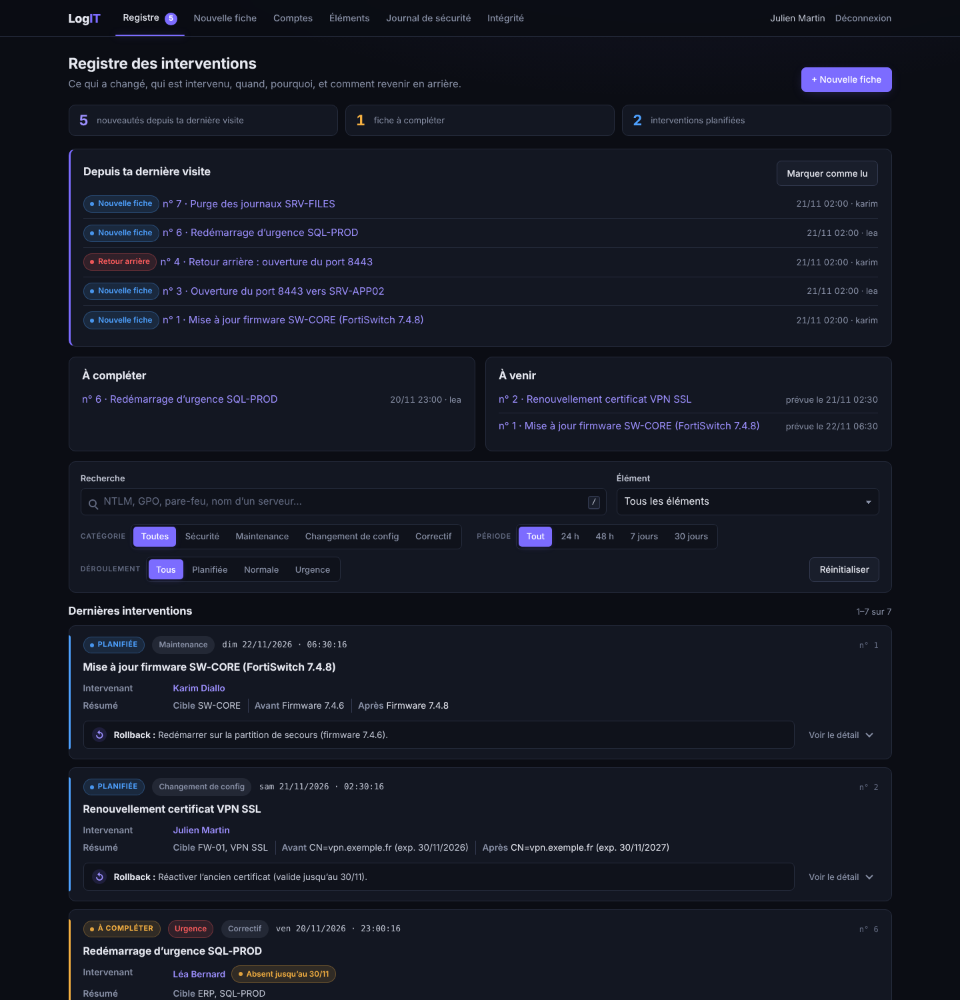
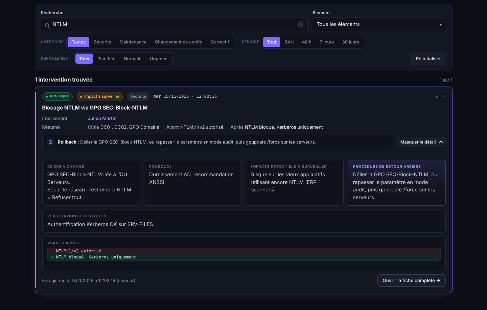
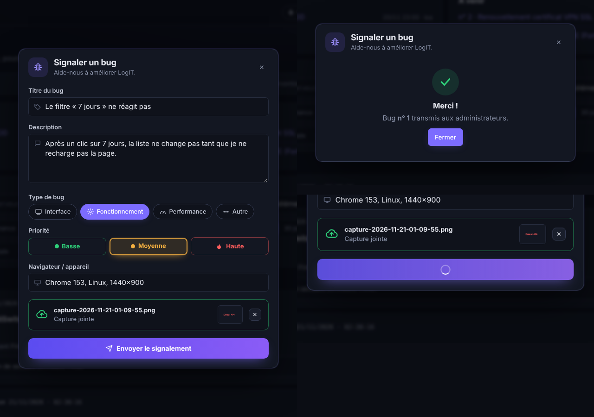

# LogIT

Registre des interventions d’infrastructure et de sécurité pour une petite équipe : **qui** a changé **quoi**, **quand**, **pourquoi**, avec quel **impact**, et **comment revenir en arrière**.



Conçu pour la traçabilité exigée par NIS2 : l’horodatage est posé par le serveur, rien ne s’efface, et la base de données elle-même refuse toute modification des traces.

## Installation

Sur un serveur **Debian 12 ou 13** (amd64 ou arm64), en root :

```bash
bash -c "$(curl -fsSL https://raw.githubusercontent.com/KyoshiroFR/logit/main/install.sh)"
```

Sur une Debian fraîchement installée, sans `curl` ni `sudo`, connecte-toi avec `su -` et utilise `wget` :

```bash
bash -c "$(wget -qO- https://raw.githubusercontent.com/KyoshiroFR/logit/main/install.sh)"
```

### Ce que fait l’installateur

Il analyse le serveur et s’adapte :

| Il trouve… | Il fait… |
|---|---|
| Docker absent | installe Docker Engine et Compose depuis le dépôt officiel Docker |
| un paquet non officiel (`docker.io`…) | s’arrête et indique quoi retirer |
| pas de synchronisation horaire | installe et active `systemd-timesyncd` (les horodatages en dépendent) |
| aucun service sur 80/443 | déploie son propre Caddy en HTTPS |
| **nginx** sur 80/443 | ajoute un site `logit.conf`, teste (`nginx -t`) puis recharge, sans toucher aux autres sites |
| **Apache** sur 80/443 | ajoute un site, active les modules nécessaires, teste puis recharge |
| **Caddy** (système) | ajoute un fichier importé, sauvegarde le Caddyfile d’origine, valide puis recharge |
| un autre service sur 80/443 | fait écouter LogIT en local et t’indique la route à ajouter dans ton proxy |
| un pare-feu ufw actif | t’indique la règle à ajouter (il ne modifie pas tes règles) |
| LogIT déjà installé et à jour | ne modifie rien |
| LogIT déjà installé, version plus ancienne | le met à jour (voir « Mise à jour ») |

Si un reverse proxy refuse la configuration, l’installateur la retire et le proxy reste dans son état d’origine.

### Secrets et premier accès

Tous les secrets (clé de l’application, mots de passe PostgreSQL, mot de passe administrateur) sont générés aléatoirement par `openssl rand`. À la fin, l’installateur affiche un bloc **« À enregistrer dans KeePass »**. Le mot de passe administrateur n’est affiché qu’une fois et n’est stocké nulle part en clair. Il doit être changé à la première connexion, puis le TOTP doit être activé.

### Variables facultatives

| Variable | Rôle |
|---|---|
| `LOGIT_INSTALL_HOSTS` | adresses d’accès (IP, noms), séparées par des espaces |
| `LOGIT_INSTALL_PROXY` | `auto` (défaut), `caddy`, `nginx`, `apache`, `host-caddy`, `manual` |
| `LOGIT_INSTALL_DIR` | dossier d’installation (défaut `/opt/logit`) |
| `LOGIT_INSTALL_REF` | version (tag ou branche) à installer |
| `LOGIT_INSTALL_YES=1` | aucune question, valeurs détectées |

## Exploitation

```
logit status            état, version, dernière sauvegarde
logit start | stop
logit logs [lignes]
logit backup            sauvegarde dans /var/backups/logit (automatique chaque nuit, 30 jours conservés)
logit restore <fichier> restaure une sauvegarde (l’état actuel est sauvegardé avant)
logit update [version]  met à jour (dernière version publiée par défaut)
logit verify            vérifie la chaîne d’empreintes
logit ca                certificat à importer sur les postes pour éviter l’alerte du navigateur
```

## Mise à jour

La commande d’installation sert aussi à mettre à jour : relancée sur un serveur où LogIT tourne, elle met à jour vers la version qu’elle publie.

```bash
bash -c "$(curl -fsSL https://raw.githubusercontent.com/KyoshiroFR/logit/main/install.sh)"
```

La commande `logit` fait la même chose :

```bash
sudo logit update            # dernière version publiée
sudo logit update v0.1.1     # une version précise
```

Dans l’ordre : sauvegarde de la base, récupération du code, construction de l’image, redémarrage avec les migrations, puis contrôle de santé et d’intégrité.
- Si la construction échoue, rien n’est modifié.
- Si le démarrage ou le contrôle d’intégrité échoue, LogIT revient **automatiquement** à la version précédente, avec la base restaurée depuis la sauvegarde faite juste avant.
- Un retour à une version plus ancienne est refusé : les migrations de base ne se défont pas. On passe alors par `logit restore`.
- Chaque mise à jour, réussie ou annulée, est inscrite dans le journal de sécurité.


## Fonctionnement

### Les fiches

- Trois types : **planifiée** (date prévue, puis « marquer réalisée »), **normale**, **urgence**. Une urgence peut être enregistrée avec le minimum (titre, éléments, modification) et reste « à compléter » jusqu’à ce que motif, impact, vérifications et retour arrière soient renseignés.
- **Deux dates** : la date d’intervention (déclarée) et la date d’enregistrement (posée par le serveur, non modifiable). Une fiche saisie plus de 15 minutes après l’intervention est signalée « saisie a posteriori ».
- **Une correction n’écrase rien** : elle ajoute une version, avec son auteur, sa date et un motif obligatoire. L’historique montre les différences ligne par ligne. Une correction de l’impact ou du retour arrière est signalée en tête de fiche.
- Une fiche ne se supprime pas : elle s’annule, avec un motif, et reste consultable.
- **Captures** : colle une capture avec Ctrl+V n’importe où sur le formulaire, ou choisis des fichiers (PNG, JPEG, WebP, 5 Mo par image, 10 par fiche). Chaque fichier est vérifié comme une vraie image. Les captures sont immuables, rattachées à la version qui les a ajoutées et incluses dans la chaîne d’empreintes.
- **Retour arrière lié** : depuis une fiche réalisée, « Consigner un retour arrière » crée une nouvelle fiche liée, préremplie avec la procédure de retour arrière et les états avant/après inversés. La fiche d’origine affiche alors « retour arrière effectué ».
- **Depuis ta dernière visite** : l’accueil liste ce que les autres ont enregistré depuis ta dernière lecture (nouvelles fiches, corrections, réalisations, annulations, retours arrière). Une correction de l’impact ou du retour arrière est mise en avant. Le menu affiche le nombre de nouveautés. « Marquer comme lu » ne masque que ce qui était affiché.

### L’interface

- **Registre** : chaque intervention est un bloc horizontal avec son état (Appliqué, Planifiée, En cours, À compléter, Rollback effectué, Annulée), l’alerte « Impact à surveiller », l’horodatage à la seconde, l’intervenant (et son absence éventuelle), le résumé Cible / Avant / Après et un encart dédié au retour arrière.
- **Enquête** : la recherche (raccourci <kbd>/</kbd>) et les filtres par élément, catégorie, période et déroulement mettent la liste à jour sans recharger la page. « Voir le détail » déploie les 4 blocs, les vérifications, le diff avant/après et les captures.
- **Saisie** : identification (catégorie, déroulement, éléments par domaine), puis 4 blocs courts : ce qui a changé, pourquoi, impacts potentiels, procédure de retour arrière. Les détails techniques sont repliés.
- **Absence** : chacun indique ses congés dans « Mon compte » (ou un admin le fait). Ses fiches affichent alors « Absent jusqu’au … ».

- **Signaler un bug** : le bouton en haut à droite, présent sur chaque page, ouvre un formulaire (titre, description, type, priorité, navigateur détecté, capture par clic, glisser-déposer ou Ctrl+V). Les administrateurs suivent les signalements dans « Bugs » (nouveau, en cours, résolu) et peuvent préparer une issue GitHub publique, sans la capture ni la page concernée.





### Les rôles

| Rôle | Droits |
|---|---|
| Administrateur | tout, plus les comptes, le référentiel, le journal de sécurité et le contrôle d’intégrité |
| Contributeur | crée, corrige, marque réalisée et annule des fiches |
| Lecteur | consulte tout, ne modifie rien |

### Sécurité et traçabilité

- Comptes nominatifs, mot de passe initial imposé (12 caractères minimum), **TOTP** imposable par compte avec 10 codes de secours à usage unique, verrouillage 15 minutes après 5 échecs, session limitée à 8 heures.
- **Journal de sécurité** : connexions réussies et échouées, verrouillages, création et modification de comptes, réinitialisations, référentiel.
- **Traces immuables au niveau de PostgreSQL** :
  - l’application se connecte avec un compte qui n’a que les droits de lecture et d’ajout sur les fiches, leurs versions et le journal ;
  - des déclencheurs refusent `UPDATE`, `DELETE` et `TRUNCATE` même au propriétaire de la base ;
  - les migrations tournent dans un conteneur séparé, seul à connaître le mot de passe propriétaire.
- **Chaîne d’empreintes** : chaque version et chaque événement contient l’empreinte SHA-256 du précédent. Une altération faite directement en base, même par un superutilisateur, est détectée par `logit verify` ou par la page Intégrité.
- HTTPS obligatoire, cookies `Secure`, `HttpOnly` et `SameSite=Strict`, CSP stricte sans script ni style en ligne, conteneur applicatif en lecture seule, sans privilège et sans root.

## Développement

Python 3.12, Django 5.2, PostgreSQL 17, interface rendue côté serveur sans framework JavaScript.

```bash
pip install -r requirements.txt
cd src
LOGIT_SECRET_KEY=dev LOGIT_TESTING=1 LOGIT_DB_HOST=127.0.0.1 \
LOGIT_DB_AS_OWNER=1 LOGIT_DB_OWNER_USER=… LOGIT_DB_OWNER_PASSWORD=… \
LOGIT_DB_APP_USER=logit_app LOGIT_DB_APP_PASSWORD=… python manage.py test journal
```

Les tests demandent un PostgreSQL réel, car ils vérifient les protections de la base.

## Publier une version

Numérotation `v0.MINEUR.CORRECTIF` jusqu’à la mise en production, qui sera la `v1.0.0` :
- un ajout de fonction incrémente le mineur : `v0.1.0` → `v0.2.0` ;
- une correction incrémente le correctif : `v0.1.0` → `v0.1.1`.

1. Créer le tag (`git tag v0.1.0 && git push origin v0.1.0`).
2. Sur `main`, renseigner dans `install.sh` `LOGIT_DEFAULT_REF` (le tag) et `LOGIT_DEFAULT_COMMIT` (`git rev-parse v0.1.0`). L’installateur refusera tout code dont le commit ne correspond pas.
