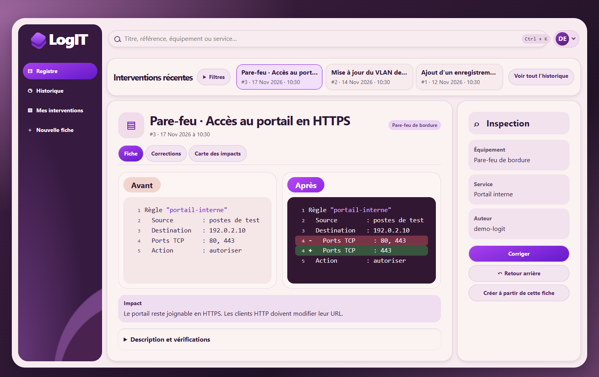
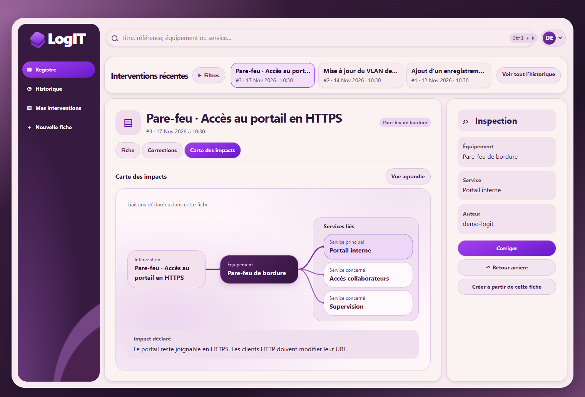

# LogIT

LogIT est un registre auto-hébergé des changements d’infrastructure et de sécurité. Il permet à l’équipe de retrouver qui a fait une intervention, de comparer l’état avant et après, et de consulter les services concernés et le plan de retour arrière.

[Installer LogIT](#installer-logit) · [Essayer en cinq minutes](#essayer-logit-en-cinq-minutes) · [Donner un retour](#donner-un-retour)





## Installer LogIT

Depuis **Linux ou Windows via WSL**, avec Bash, `curl` et Docker Compose disponibles, lance cette commande dans le répertoire qui accueillera le dossier `logit`.

```bash
installateur=$(curl -fsSL https://logit.kyoshiro.ovh/install.sh) && bash -c "$installateur"
```

L’installation démarre avec une base vide. Le terminal affiche le mot de passe temporaire de `admin-logit`, à remplacer lors de la première connexion. Ouvre ensuite [https://localhost:6321](https://localhost:6321).

- **Certificat local**. Si le navigateur signale que le certificat est inconnu, exporte l’autorité publique de ton conteneur Caddy, puis importe-la dans le magasin de confiance du navigateur de test. Cette commande utilise le nom de l’instance par défaut.

  ```bash
  docker cp logit-proxy:/data/caddy/pki/authorities/local/root.crt logit-local-ca.crt
  ```

- **Ports déjà utilisés**. Depuis un autre dossier, tu peux lancer une instance distincte sur les ports `16320` et `16321`, puis ouvrir `https://localhost:16321`.

  ```bash
  installateur=$(curl -fsSL https://logit.kyoshiro.ovh/install.sh) &&
    LOGIT_INSTALL_INSTANCE=logit-test LOGIT_INSTALL_HTTP_PORT=16320 LOGIT_INSTALL_HTTPS_PORT=16321 bash -c "$installateur"
  ```

Retrouve [la release v1.0.0](https://github.com/KyoshiroFR/logit/releases/tag/v1.0.0), ou consulte [la documentation](docs/README.md) pour la sauvegarde et la restauration.

## Essayer LogIT en cinq minutes

1. Dans **Administration**, crée un équipement fictif nommé « Pare-feu de test » et un service « VPN de test ».
2. Dans **Nouvelle fiche**, consigne une modification fictive. Indique son impact, la vérification effectuée et la procédure de retour arrière. Ajoute les états avant et après et colle une capture anonymisée avec **Ctrl+V**.
3. Demande à un collègue de retrouver la fiche dans **Historique**, puis d’ouvrir **Carte des impacts** et **Retour arrière**. Sur une instance locale, tu peux rejouer ce parcours avec un second compte dans une fenêtre privée.
4. Partage le premier endroit où vous avez hésité ou l’information qu’il vous a fallu chercher ailleurs. Utilise le modèle de retour ci-dessous.

## Donner un retour

- [Signaler un bug ou un problème d’installation](https://github.com/KyoshiroFR/logit/issues/new?template=bug_report.md)
- [Proposer une amélioration ou partager un retour d’expérience](https://github.com/KyoshiroFR/logit/issues/new?template=feedback.md)

Les Issues sont publiques. Utilise des exemples fictifs ou des captures anonymisées.
